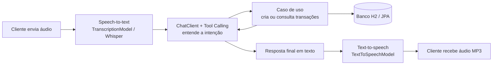

# 💰 Budgeting Spring AI — API de orçamento com comandos de voz

Projeto do **Desafio de Projeto com Spring Boot e Spring AI (DIO)**.
É uma API de orçamento pessoal em que o usuário **fala** (ou escreve) um comando como
*"gastei 45 reais no almoço"* ou *"com o que eu mais gastei este mês?"* e a IA registra ou consulta
transações financeiras de verdade, respondendo em texto e em áudio.

> Base: trilha [dio-spring-boot-learning-track](https://github.com/digitalinnovationone/dio-spring-boot-learning-track)
> (módulo `05-spring-ai`). A estrutura em camadas e o fluxo principal seguem o projeto do expert;
> as melhorias estão descritas [mais abaixo](#-melhoria-implementada).

---

## 🔄 Como funciona (fluxo principal)



1. O cliente envia um arquivo de áudio para `POST /api/ai/voice-command`.
2. O áudio é transcrito em texto (`TranscriptionModel`).
3. O `ChatClient` entende a intenção e escolhe uma **ferramenta** (`@Tool`).
4. A ferramenta chama um **caso de uso** da aplicação (o mesmo usado pelo REST).
5. O resultado volta para o modelo, que gera a resposta final.
6. A resposta é convertida em áudio (`TextToSpeechModel`) e devolvida em MP3.

## 🗂️ Estrutura do projeto

```
src/main/java/dio/budgeting
├── domain            # modelo de domínio e contrato do repositório (sem Spring)
├── application       # casos de uso (usados pelo REST e pelo Tool Calling)
└── infrastructure
    ├── persistence   # adaptador JPA (H2)
    ├── web           # controllers REST e tratamento de erros
    └── ai            # ChatClient, ferramentas @Tool, fluxo de voz
```

A regra é: **a IA não fura a arquitetura**. As ferramentas (`BudgetingTools`) não têm regra de negócio,
só traduzem parâmetros e chamam os casos de uso.

## ✨ Melhoria implementada

Escolhi uma melhoria pequena e completa, em três partes:

1. **Validações antes de salvar** (`CreateTransactionUseCase`): descrição obrigatória (até 120 caracteres),
   valor maior que zero, no máximo 2 casas decimais e até R$ 10.000.000, tipo obrigatório,
   data não pode estar no futuro, categoria normalizada (minúscula, padrão `outros`).
   Todas as violações são devolvidas de uma vez (HTTP 400 com a lista `violations`).
   Quando o erro vem de um comando de voz, a ferramenta devolve a mensagem ao modelo,
   que **explica o problema ao usuário** em vez de quebrar.
2. **Novas ferramentas / consultas financeiras**: além de criar transação, a IA agora também consegue
   **listar com filtros** (período, tipo, categoria), calcular o **saldo** e mostrar as
   **despesas por categoria** com percentual (`GET /api/transactions/spending-by-category`).
3. **Testes e documentação**: testes unitários dos casos de uso e das ferramentas, teste do fluxo de voz
   com modelos *mockados* e teste de integração dos endpoints (nenhum deles precisa de chave da OpenAI);
   Swagger UI e arquivo `requests.http` com exemplos.
   Também adicionei `POST /api/ai/text-command`, para testar a IA sem enviar áudio.

## 🛠️ Tecnologias

Java 21 · Spring Boot 3.5 · Spring AI 1.1 (OpenAI: chat, Whisper e TTS) · Spring Data JPA · H2 ·
springdoc-openapi (Swagger) · JUnit 5 · Mockito · AssertJ · Gradle

## ▶️ Como executar

Pré-requisitos: **JDK 21** e uma chave da OpenAI.

```bash
# 1. defina a chave (Linux/macOS)
export OPENAI_API_KEY="sua_chave_aqui"
# Windows PowerShell:  $env:OPENAI_API_KEY="sua_chave_aqui"

# 2. gere o Gradle Wrapper (só na primeira vez, se a pasta gradle/ ainda não existir)
gradle wrapper

# 3. rode
./gradlew bootRun
```

- API: <http://localhost:8080>
- Swagger UI: <http://localhost:8080/swagger-ui.html>
- Console do H2: <http://localhost:8080/h2-console> (JDBC URL: `jdbc:h2:mem:budgeting`, usuário `sa`, sem senha)

> Os dados ficam em memória: ao reiniciar a aplicação, o banco começa vazio.

## 🧪 Como testar o fluxo principal

### Testes automatizados (não precisam de chave)

```bash
./gradlew test
```

### Teste manual sem áudio (texto)

```bash
curl -X POST http://localhost:8080/api/ai/text-command \
  -H "Content-Type: application/json" \
  -d '{"text":"Gastei 32 reais e 50 no mercado hoje"}'

curl -X POST http://localhost:8080/api/ai/text-command \
  -H "Content-Type: application/json" \
  -d '{"text":"Com o que eu mais gastei até agora?"}'
```

### Teste manual com áudio (fluxo completo)

Grave um áudio curto (mp3, wav, m4a...) dizendo, por exemplo, *"gastei quarenta e cinco reais no almoço"*:

```bash
curl -X POST http://localhost:8080/api/ai/voice-command \
  -F "audio=@comando.mp3" \
  -D - \
  --output resposta.mp3
```

A resposta é um MP3 (`resposta.mp3`). O texto transcrito e o texto da resposta vêm nos headers
`X-Transcription` e `X-Assistant-Text` (URL-encoded, porque headers HTTP não aceitam acentos).

### Testando o REST direto

Veja `requests.http` ou use o Swagger UI.

| Método | Endpoint | Descrição |
|---|---|---|
| POST | `/api/transactions` | Cria uma transação (com validações) |
| GET | `/api/transactions` | Lista com filtros `start`, `end`, `type`, `category` |
| GET | `/api/transactions/balance` | Receitas, despesas e saldo do período |
| GET | `/api/transactions/spending-by-category` | Despesas agrupadas por categoria |
| POST | `/api/ai/voice-command` | Áudio → ação → áudio (MP3) |
| POST | `/api/ai/text-command` | Texto → ação → texto |

## 📸 Exemplos e prints

> _Adicione aqui prints do Swagger UI, de uma resposta do `text-command` e dos testes passando
> (`./gradlew test`)._

## 📚 O que aprendi

> _Reescreva esta seção com as suas palavras. Sugestão de pontos:_

- Como o **Tool Calling** funciona: o modelo não executa nada, ele *pede* para a aplicação chamar uma função.
- Por que manter a regra de negócio nos **casos de uso**: REST e IA usam exatamente o mesmo código e as mesmas validações.
- Devolver erros de validação como resultado da ferramenta permite que a IA explique o problema ao usuário.
- Como testar partes que dependem de IA usando **mocks** (`TranscriptionModel`, `TextToSpeechModel`).
- Como conectar speech-to-text, LLM e text-to-speech em um único fluxo.

## ⚠️ Observações

- Projeto educacional. Chamadas reais de voz/IA consomem créditos da sua conta OpenAI.
- Nunca suba sua chave da OpenAI para o GitHub: use sempre a variável de ambiente `OPENAI_API_KEY`.
